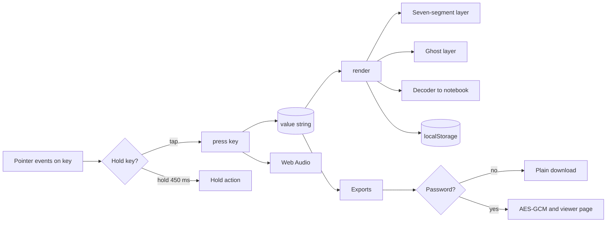

# Kompri

**A private, pocket-sized cipher keypad: a 4×4 seven-segment terminal that encodes and decodes text, in a single HTML file.**


Kompri turns sixteen keys into a complete writing system. You type a compact code of digits, dots and dashes on an LED-style keypad. A seven-segment display shows exactly what you typed, and a collapsible notebook decodes it into readable text in real time. Everything runs in the browser: no server, no account, no network requests, no build step.

---

## Table of contents

1. [Highlights](#highlights)
2. [Quick start](#quick-start)
3. [The cipher](#the-cipher)
4. [Keypad reference](#keypad-reference)
5. [Display system](#display-system)
6. [Themes](#themes)
7. [Sound design](#sound-design)
8. [Editing tools: copy and paste](#editing-tools-copy-and-paste)
9. [Exports and file protection](#exports-and-file-protection)
10. [Passcode lock](#passcode-lock)
11. [Persistence](#persistence)
12. [Security model](#security-model)
13. [Architecture](#architecture)
14. [Browser support](#browser-support)
15. [Accessibility](#accessibility)
16. [Deployment](#deployment)
17. [Manual test plan](#manual-test-plan)
18. [Troubleshooting](#troubleshooting)
19. [Roadmap](#roadmap)
20. [Credits and licensing](#credits-and-licensing)

---

## Highlights

- **One file, zero dependencies.** HTML, CSS, JavaScript, and the display font (embedded as base64) live in a single document of about 60 KB.
- **Seven-segment display with unlit segments.** Every character occupies one fixed-width cell, with a faint ghost "8" behind it like a real LCD or LED module.
- **Custom segment designs.** Selected digits and letters are redrawn at the glyph level (see [Display system](#display-system)).
- **Live decoding notebook.** A collapsible, ruled-paper panel shows the decoded message in lowercase as you type. It stays closed by default so the plain text is not on screen.
- **Hold gestures with visual feedback.** Five keys carry a second function on a 450 ms hold, shown by a progress bar along the bottom of the key.
- **Synthesized sound.** Twelve distinct Web Audio sounds, no audio files. A scale on the digits, effects on the letters.
- **Two themes.** A neon dark theme (default) and a clean white theme, with the LED glow tied to the sound state.
- **Word-level copy and paste** directly on the display.
- **Timestamped downloads** as `.txt` or `.jpg`, optionally wrapped in an AES-256-GCM protected viewer page.
- **Optional passcode gate** on page open.

---

## Quick start

### Run locally

1. Save the file as `index.html`.
2. Open it in any modern mobile or desktop browser.

No installation, server, or build tooling is required.

### Your first message

Type `-.` `1` `-7` `-7` `0` `-` and open the notebook (tap the notebook bar). It reads:

```
hello.
```

| Typed | Reads as |
|---|---|
| `-.` | h |
| `1` | e |
| `-7` | l |
| `-7` | l |
| `0` | o |
| `-` | . (full stop) |

---

## The cipher

Kompri uses a monoalphabetic substitution built from eleven base symbols: the digits `0` to `9` and the dot `.`. Each symbol has two meanings. The plain symbol gives one letter, and the same symbol preceded by a minus gives a second letter. That yields 22 letters directly.

### Letter table

| Symbol | Plain | With minus | | Symbol | Plain | With minus |
|:--:|:--:|:--:|---|:--:|:--:|:--:|
| `1` | E | I (`-1`) | | `7` | R | L (`-7`) |
| `2` | K | G (`-2`) | | `8` | P | B (`-8`) |
| `3` | Y | J (`-3`) | | `9` | F | V (`-9`) |
| `4` | N | M (`-4`) | | `0` | O | U (`-0`) |
| `5` | S | C (`-5`) | | `.` | A | H (`-.`) |
| `6` | T | D (`-6`) | | | | |

### Compound letters

Four rare letters have no dedicated code. They are spelled with letters that already exist:

| Letter | Spelled as | Keys |
|:--:|:--:|---|
| Q | KV | `2` `-9` |
| W | VV | `-9` `-9` |
| X | KS | `2` `5` |
| Z | SJ | `5` `-3` |

Example: "wow" is typed `-9-9` `0` `-9-9` and decodes to `vvovv`. The reader folds each `vv` back into a W by context.

### Punctuation and whitespace

| Input | Output |
|---|---|
| `-` on its own | `.` full stop |
| `--` | `,` comma |
| `D` key | space |
| `D` pressed right after a space | that space becomes a line break |

### Decoding grammar

The decoder is a single left-to-right scan with fixed precedence:

```
stream  := ( space | newline | token )*
token   := "--"                    → ","
         | "-" ( digit | "." )     → minus-letter
         | "-"                     → "."
         | ( digit | "." )         → plain-letter
```

At each `-`, the decoder checks the next character:

1. Next is `-`: emit a comma and consume both.
2. Next is a digit or `.`: emit the minus-letter and consume both.
3. Otherwise: emit a full stop and consume one.

Every possible character typed on the keypad has a defined output, so the notebook never has to show an error placeholder for valid input.

**Known ambiguity.** `--1` reads as a comma followed by `E`, never as a full stop followed by `I`. Press `D` (space) after punctuation, which is also natural writing, and the ambiguity does not arise.

---

## Keypad reference

### Layout

```
┌───┬───┬───┬───┐
│ 1 │ 2 │ 3 │ A │
├───┼───┼───┼───┤
│ 4 │ 5 │ 6 │ B │
├───┼───┼───┼───┤
│ 7 │ 8 │ 9 │ C │
├───┼───┼───┼───┤
│ . │ 0 │ - │ D │
└───┴───┴───┴───┘
```

### Tap actions

| Key | Color | Tap |
|:--:|---|---|
| `0`–`9`, `.`, `-` | per key | Types the symbol |
| `A` | red | Delete last character |
| `B` | orange | Download the display as a JPG |
| `C` | green | Download the decoded message as a TXT |
| `D` | blue | Space (twice in a row: line break) |

Each digit key shows its two letters as a hint (for example `E,I` on `1`). The `A`, `B`, `C` and `D` keys show icons for their functions.

### Hold actions

A hold is **450 ms**. A progress bar fills along the bottom of the key, starting after a 120 ms delay so quick taps never show it.

| Key | Hold | Triggers on |
|:--:|---|---|
| `A` | Clear everything (asks for confirmation) | Timer |
| `.` | Switch between dark and light theme | Timer |
| `-` | Mute or unmute sound | Timer |
| `0` | Toggle full screen | Release |
| `D` | Set or remove the passcode | Timer |

Full screen fires on release because browsers only allow it inside a user-activation event, and a timer callback during a touch does not qualify.

After a hold completes, the tap that follows the release is suppressed so the key never types its character by accident.

---

## Display system

The screen is split vertically into three zones: the seven-segment display, the notebook, and the keypad. The display and the notebook share the upper two thirds of the height. When the notebook is collapsed, the display takes the whole upper area.

### Seven-segment display

- **Font.** DSEG7 Classic Bold, embedded as a base64 TrueType file so the page works offline.
- **Fixed cells.** Every glyph, including space, has the same advance width (0.94 em), so characters sit in uniform cells like a physical module. The decimal point was removed from the design.
- **Ghost segments.** A second layer behind the text draws an "8" in every occupied cell at low opacity, giving the classic unlit-segment look. It has one extra cell for the cursor.
- **Cursor.** A blinking horizontal bar in the shape and position of segment *d* (the bottom segment). The blink is disabled when the system requests reduced motion.
- **Scrolling.** Text does not wrap. Long lines scroll horizontally, many lines scroll vertically, and the view follows the cursor.

### Custom segment designs

These glyphs were rebuilt from the individual segment outlines of the original font. Segments are lettered *a* (top), *b* (upper right), *c* (lower right), *d* (bottom), *e* (lower left), *f* (upper left), *g* (middle).

| Glyph | Segments lit |
|:--:|---|
| `2` | a, b, e, g |
| `3` | a, b, c, d |
| `4` | c, f, g |
| `9` | a, b, c, f, g |
| `0` | a, b, c, d, e, f |
| `A` | a, b, c, e, f |
| `B` | c, d, e, f |
| `C` | c, d, e, g |
| `D` | c, d, e |
| `.` | c, d (a full cell, with no decimal point) |
| `-` | g |

### Notebook

- Collapsed by default, with a notebook icon and a chevron.
- Decodes the full message live, in lowercase.
- Ruled lines, a margin line, and a modern sans font, themed for dark and light.
- Contents are also what the TXT export saves.

---

## Themes

| | Dark (default) | Light |
|---|---|---|
| Page and screen | Near-black navy | White |
| Segments | White, with a soft glow | Dark teal |
| Keys | Solid color with LED glow | Solid color with soft shadow |
| Key labels | Dark | Dark |
| Notebook | Dark paper, light ink | White paper, dark ink |

Hold `.` to switch. The choice persists.

### Key palette

| Key | Hex |
|---|---|
| Digits | `#aab4d4` |
| `A` | `#ff3b5c` |
| `B` | `#ff9f1c` |
| `C` | `#2cff7a` |
| `D` | `#2f9bff` |
| `.` | `#c25cff` |
| `-` | `#ffff00` |

### LED glow and mute

In the dark theme, each key has a three-layer glow in its own color plus a soft inner highlight, and a thin dotted line runs just inside the key edge. The glow is tied to the sound state: **sound on means glow on, muted means flat keys.** This gives an at-a-glance indicator without extra UI.

---

## Sound design

All audio is synthesized with the Web Audio API. There are no audio files.

### Tones

| Key | Sound |
|:--:|---|
| `1` | B3 (246.94 Hz), the note just below the scale |
| `2`–`9` | C major scale, C4 up to C5 (261.63 to 523.25 Hz) |
| `0` | D5 (587.33 Hz), the note just above the scale |

Notes use a triangle wave with a 10 ms attack and a 0.4 s exponential decay.

### Effects

| Key | Effect | Construction |
|:--:|---|---|
| `A` | Error buzz | Two descending sawtooth bursts |
| `B` | Low chime | Sine at 330 Hz plus inharmonic partials (2.76× and 5.4×), 1.4 s ring |
| `C` | Firework | Rising whistle, a filtered-noise boom, then a random crackle |
| `D` | Bubble blop | Sine glide from 250 to 800 Hz, with a short overtone |
| `.` | Dot dot | Two 700 Hz blips |
| `-` | Sweep | Triangle glide from 200 to 1600 Hz |

Sounds start on pointer-down, not on release, for immediate feedback. The audio context is created on the first interaction to satisfy autoplay rules. Hold `-` to mute.

---

## Editing tools: copy and paste

Operations work on the seven-segment display, using the typed code.

- **Tap a word** to copy it. The word flashes, the phone vibrates briefly, and the word is stored internally and written to the system clipboard when the browser allows it.
- **Tap empty space** to paste the stored word at that position. Kompri uses the caret position under the tap (`caretRangeFromPoint` or `caretPositionFromPoint`) to find the insertion index and adds spaces around the word when needed. If the position cannot be determined, the word is appended at the end.
- The stored word persists, so you can paste it repeatedly.

A "word" is any run of non-whitespace characters.

---

## Exports and file protection

### File names

Downloads use the pattern `ddmmyyyyhhmmss`:

```
14112026011113.txt
14112026011113.jpg
14112026011113-protected.html
```

### Text export (`C`)

Saves the **decoded**, lowercase message as UTF-8 plain text.

### Image export (`B`)

Renders the display to a canvas and downloads it as a JPEG (quality 0.95).

- Size is determined by the content: the width is the longest line, the height is the line count.
- Uses the current theme's colors, including the faint unlit segments.
- Rendered at a 96 px font size for a sharp result.

### Password protection

Each download asks for an optional password:

- **Empty password:** the file downloads as is.
- **Password set:** the content is encrypted in the browser and wrapped in a self-contained viewer page.

| Parameter | Value |
|---|---|
| Cipher | AES-GCM, 256-bit key |
| Key derivation | PBKDF2, HMAC-SHA-256, 200,000 iterations |
| Salt | 16 random bytes |
| IV / nonce | 12 random bytes |
| Authentication | GCM tag (wrong password or tampering fails to decrypt) |

The resulting `-protected.html` file contains the ciphertext, salt and IV as base64, plus a small script that asks for the password and decrypts locally. It displays the text or the image on success and shows "Wrong password" otherwise. It needs no server and works offline in any modern browser.

> **There is no password recovery.** Forgotten passwords cannot be reset.

The Web Crypto API requires a secure context (HTTPS or localhost, plus most `file://` setups). If it is unavailable, Kompri says so instead of saving an unprotected file.

---

## Passcode lock

Hold `D` to set a passcode, or to remove it if one is set.

- On page load the app shows a solid screen with a passcode prompt. The prompt cannot be cancelled.
- Wrong entries show a message and ask again.
- The stored value is a salted PBKDF2-SHA-256 hash (100,000 iterations, 16-byte salt), never the passcode itself.
- Removing the passcode requires entering it first.

This is a **screen lock**. See the [security model](#security-model) for what it does and does not protect.

---

## Persistence

State lives in `localStorage`. Every access is wrapped in `try/catch`, so the app still works (without memory) where storage is blocked.

| Key | Contents |
|---|---|
| `keypad-text` | The raw typed code |
| `keypad-light` | `"1"` when the light theme is active |
| `keypad-mute` | `"1"` when sound is muted |
| `keypad-lock` | JSON `{ s, h }`: base64 salt and hash of the passcode |

Clearing site data erases all of it.

---

## Security model

Kompri has three separate protection layers, and they differ a lot in strength.

| Layer | What it is | Protects against | Does not protect against |
|---|---|---|---|
| **The cipher** | Simple substitution code | Casual glances at the display | Anyone who knows or deduces the table; letter-frequency analysis |
| **Passcode lock** | UI gate with a hashed passcode | Someone picking up an unlocked phone and opening the page | Someone inspecting browser storage: the typed text is stored unencrypted |
| **Protected export** | AES-256-GCM with PBKDF2 | Anyone without the password who obtains the file | A weak password; a compromised device |

Treat the cipher as **obfuscation, not encryption**. Treat protected exports as the real security feature, and choose a long password.

Other notes:

- No data leaves the device. The app makes no network requests.
- The notebook is collapsed by default so decoded text is not visible by accident.
- The clipboard receives the typed code, not the decoded text, when you copy a word.

---

## Architecture

### Overview



### Single source of truth

One string, `value`, holds everything typed. `render()` rebuilds every view from it:

1. The foreground layer, with one span per word so words can be tapped.
2. The ghost layer, with one "8" per character per line, plus one cell for the cursor.
3. The notebook, via `decode(value).toLowerCase()`.
4. The persisted copy in `localStorage`.

### Inside the file

| Section | Responsibility |
|---|---|
| `<head>` | Viewport, color-scheme, title and favicon (inline SVG), embedded font, all CSS |
| CSS variables | Theme tokens: `--panel`, `--screen`, `--screen-ink`, `--ghost`, `--paper`, per-key `--c` |
| Markup | Display, accordion, dialog, keypad container |
| Cipher | `MAP` table and `decode()` |
| Audio | `osc()`, `noise()`, `SFX` table, `tone()` |
| Dialogs | `ask()`: a promise-based modal used for confirmations and prompts |
| Crypto | Password hashing, AES-GCM encryption, protected-viewer generator |
| Keys | `holdBind()` and the per-key handlers |
| Gestures | Word copy and paste, caret lookup |

### Notable design decisions

- **Pointer Events, not touch and mouse.** One code path for fingers, mice and pens.
- **Hold detection with release suppression.** A `held` flag swallows the click that follows a hold.
- **Stuck-state cleanup.** A document-level listener clears the pressed and holding classes on every pointer or touch end, because some mobile browsers drop the release event after a long press.
- **Inline everything.** The font, icons and favicon are inline, so there is nothing to fetch.
- **Dynamic viewport height** (`100dvh`) keeps the layout steady as mobile address bars appear and disappear.
- **`color-scheme: dark light`** tells the browser the page manages its own colors, which stops Chromium-family browsers from force-darkening the keys.

---

## Browser support

Kompri targets current evergreen mobile browsers.

| Feature | Needed for | Notes |
|---|---|---|
| Pointer Events | All input | Universal |
| Web Audio | Sound | Universal; iOS may mute it with the ringer switch |
| `color-mix()` | Key glow and pressed states | Chrome 111+, Safari 16.2+, Firefox 113+ (approximate) |
| `100dvh` | Stable layout | Chrome 108+, Safari 15.4+, Firefox 101+ (approximate) |
| Web Crypto (`crypto.subtle`) | Protected exports, passcode | Requires a secure context |
| Fullscreen API | Hold `0` | Not available for web pages on iPhone Safari |
| Vibration API | Haptic feedback | Android only; skipped silently elsewhere |

---

## Accessibility

- Every key has an `aria-label` describing its function, for example "delete. Hold to clear all".
- The display and notebook are exposed as a read-only text box and a live region.
- The accordion uses `aria-expanded` and `aria-controls`.
- Dialogs use `role="alertdialog"` with `aria-modal`, and focus moves into them.
- Motion (the cursor blink and the key transitions) is reduced when the system asks.
- Key labels are dark on solid colors for strong contrast.

Known gaps: the hint text under keys is 9 px, and there is no hardware-keyboard input mode.

---

## Deployment

### GitHub Pages

1. Rename the file to `index.html` and commit it to a repository.
2. Open **Settings → Pages**.
3. Choose **Deploy from a branch**, select `main` and `/ (root)`, and save.
4. Your app will be live at `https://<user>.github.io/<repo>/`.

Hosting over HTTPS also makes the passcode and protected exports work reliably, since `crypto.subtle` needs a secure context.

### Suggested repository layout

```
.
├── index.html     # the entire application
├── README.md
├── LICENSE
└── docs/          # screenshots and notes (optional)
```

### Add to home screen

On mobile, use the browser menu's **Add to Home Screen** to open Kompri without browser chrome. This is also the way to get full screen on iPhone.

---

## Manual test plan

Run through this on a real phone before publishing.

| Area | Check |
|---|---|
| Typing | Each key types its symbol; sounds play; keys light and dim on press |
| Decoding | `-.` `1` `-7` `-7` `0` `-` gives `hello.`; `--` gives a comma; `-9-9` gives `vv` |
| Whitespace | `D` adds a space; a second `D` makes a line break |
| Delete | `A` removes one character; a hold shows the progress bar, then the confirm dialog |
| Confirm | Cancel keeps the text; Clear empties the screen and the notebook |
| Theme | Hold `.` switches themes; the choice survives a reload |
| Mute | Hold `-`; the glow turns off and sounds stop; repeat to restore |
| Full screen | Hold `0` on Android or desktop; on iPhone, expect the explanatory message |
| Notebook | Collapsed by default; the toggle opens and closes it; the text is lowercase |
| Copy and paste | Tap a word (flash), tap empty space (inserted) |
| Exports | Both download with a timestamped name; empty password gives plain files |
| Protection | A password gives an HTML file that unlocks only with the right password |
| Passcode | Set, reload and be asked, fail once, succeed, then remove |
| Persistence | Reload keeps text, theme, and mute state |
| Layout | No jump when the address bar shows or hides; rotate to check landscape |

---

## Troubleshooting

**The yellow key looks dark and the labels are white.**
A browser's forced dark mode (for example Brave's or Chrome's "auto dark mode for web contents") can recolor the page. Kompri declares `color-scheme: dark light` to opt out. If you still see it, turn that browser setting off.

**Changes do not appear after I update the file.**
You are probably viewing a cached or older downloaded copy. Reload without cache, or download the file again.

**Full screen does nothing on iPhone.**
iPhone Safari does not allow full screen for web pages. Use Add to Home Screen.

**The protected download will not open or unlock.**
Open the downloaded HTML file in a real browser (Safari, Chrome), not a file previewer. Password protection requires a browser with Web Crypto in a secure context.

**Sounds do not play on iPhone.**
Check the ringer or silent switch and the volume, and confirm Kompri is not muted (hold `-`).

**A quick tap on a key does something unexpected.**
A press longer than about half a second counts as a hold. Tap more briefly on `A`, `.`, `-`, `0` and `D`.

---

## Roadmap

- In-app help screen listing the cipher and the hold gestures
- Home-screen icon set and installable web-app manifest
- Landscape-optimized layout
- Optional auto-collapse and auto-lock after inactivity
- Encrypted-at-rest storage for the typed text
- Share-sheet integration for exports
- Hardware-keyboard input mode
- Configurable cipher table

---

## Credits and licensing

### Display font

Kompri embeds a modified build of **DSEG7 Classic Bold** by keshikan, from the [DSEG project](https://github.com/keshikan/DSEG), which is released under the SIL Open Font License 1.1. The embedded copy has redrawn glyphs for several digits and letters, a uniform glyph width, and a changed period glyph.

> **Before publishing:** review the DSEG license text for any reserved font name and for renaming requirements on modified versions, and include the license notice in your repository.

### Project license

Add a `LICENSE` file of your choice (for example MIT) and state it here.

```
Copyright (c) <year> <your name>
```
